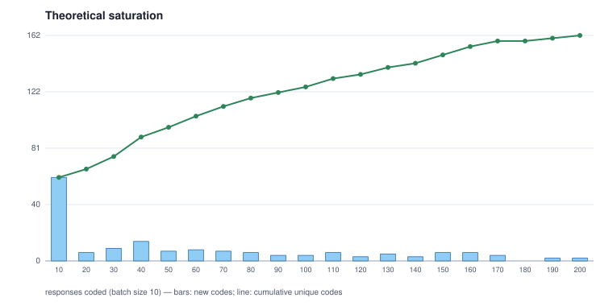

# Results

This directory holds what the pipeline produced on the real survey responses, exported as
Markdown and figures by `scripts/export_results.py`. No respondent's words appear anywhere
in it (see [Privacy](#privacy)). This page is the way in: what was run, what came out, what
was built to get there, what was and was not tested, what would be done differently, and
what has not been tried. Each folder has its own README with the tables behind the claims.

## The short version

- The pipeline runs end to end on local models, costs nothing, and takes about 105 seconds
  of model time per response. Two coders from different model families code each response,
  a judge rules on the disagreements, and every step is logged.
- **Its leaf codes do not line up with the PI's.** On the 19 held-out responses he coded, code-level
  kappa lies between -0.038 and +0.092 and F1 between 0.028 and 0.150 across twelve
  measurements and six configurations. By the exporter's own rule, a kappa under 0.1 is
  within chance. Rolled up to his 15 families the same runs reach kappa +0.34 to +0.56, above a
  shuffled-response chance level, but not clearly above a predictor that only repeats his most
  common themes. So part of the leaf-level zero is vocabulary; the rest is not yet diagnosed
  ([agreement-checks.md](agreement-checks.md)).
- **Nothing tried so far moves that number.** More responses (39 to 200), different
  thresholds, and three different coder models changed the size of the codebook a lot (20
  to 48 families, 73 to 162 codes) and agreement hardly at all.
- **None of this is the approved line-up.** Claude Opus 5.5 with hosted Qwen3.8-Max has not
  been run: it waits on the PI confirming the two data processors and on the API keys. The
  local runs test the pipeline, and say nothing about what those models would find.

## Where things are

| folder | what it is |
|---|---|
| [`HOW-THE-RESULTS-WERE-REACHED.md`](HOW-THE-RESULTS-WERE-REACHED.md) | The run history: twelve steps, each with the question it asked, what changed, what happened and what it led to. |
| [`agreement-checks.md`](agreement-checks.md) | Agreement with the PI with intervals, a chance level, a trivial predictor, a family-level roll-up, and four-fold calibration. |
| [`india-process-39-local/`](india-process-39-local/README.md) | The 39 responses the PI coded, coded cold by local models, plus four comparison runs on the same 39 (one threshold change, three coder swaps). Start at `00-at-a-glance.md`; the side-by-side is `17-comparison.md`. |
| [`india-process-1-200-local/`](india-process-1-200-local/README.md) | All 200 responses coded cold by local models: vocabulary growth, saturation, the full analysis tail. |
| [`india-process-1-200/`](india-process-1-200/README.md) | The same 200 with the offline stand-in coder (a keyword table, not a model), with a seeded run and a halt-and-resume. The baseline the local runs are read against. |
| [`india-process-1-20/`](india-process-1-20/README.md) | The 10 September meeting document. Not regenerated. |
| [`india-state-1-20/`](india-state-1-20/README.md) | The State sample under its own question, offline. Not regenerated. |

## Every run, in one table

All local runs use the default thresholds (tau_fit 0.30, tau_high 0.80, tau_low 0.45) unless
the "what changed" column says otherwise. Coder A is `qwen3.5:9b` unless changed; coder B, the
judge and the refactorer are `gemma4:12b`; embeddings are `embeddinggemma`. Agreement is on
the 19 held-out responses (a fold fixed in advance), kappa and F1 over response-by-code cells,
with descriptions first and by name only after the slash.

| run | responses | what changed | codes (families) | wall time | fail-safes | held-out kappa | held-out F1 |
|---|---:|---|---:|---:|---:|---:|---:|
| calibration fold `local-cal20` | 20 | nothing; the fold used to calibrate | 68 (25) | 15 min 45 s | 0 | n/a | n/a |
| baseline `local-eval39` | 39 | nothing | 91 (31) | 1 h 46 min, 47 min of it model time | 0 | -0.010 / +0.011 | 0.050 / 0.071 |
| `local-eval39-plateau` | 39 | thresholds 0.90 / 0.95 / 0.90 | 125 (39) | 65 min | 0 | +0.018 / +0.038 | 0.074 / 0.095 |
| `local-eval39-qwen25` | 39 | coder A: qwen2.5:7b-instruct | 73 (22) | 50 min | 0 | +0.006 / +0.092 | 0.068 / 0.150 |
| `local-eval39-llama31` | 39 | coder A: llama3.1:8b | 93 (36) | 53 min | 0 | -0.016 / -0.001 | 0.043 / 0.057 |
| `local-eval39-mistral` | 39 | coder A: mistral:7b-instruct | 75 (20) | 51 min | 0 | -0.038 / -0.010 | 0.028 / 0.057 |
| cold run `local-cold200` | 200 | all responses, no seed | 162 (48) | 4 h 45 min | 2 | -0.009 / +0.012 | 0.050 / 0.072 |
| seeded run `local-seeded161` | 10 of 161 | seeded with the PI's codebook; halted at the first checkpoint | 134 (15), 3 new | 17 min | 0 | not measured | not measured |

The baseline's wall time includes an hour in which the laptop slept; its model time was 47
minutes. The seeded run stopped on purpose after 10 responses so that the PI could act as the
human gate; 151 responses remain uncoded and the gate has not been run.


## What the runs show

(Findings 1 to 9 come from the runs; finding 10 from re-reading them.)

1. **Agreement with the PI is at chance in every configuration.** Across the five 39-response
   runs, and the 200-response run on the same held-out fold, no kappa reaches 0.1. The offline
   stand-in coder gave the same picture earlier (kappa about -0.04 and -0.01). The PI's
   coding fills about 146 response-by-code cells in the held-out fold; the runs agree on 4 to
   20 of them. The "matched codes only" kappas (0.55 to 0.70) cover a handful of codes and are
   not a headline.
2. **More data adds vocabulary, not agreement.** Going from 39 to 200 responses took the
   codebook from 91 codes in 31 families to 162 in 48, saturating at batch 18 of 20, and left
   held-out kappa where it was (-0.010 and -0.009 with descriptions).
3. **Calibration says the defaults are wrong, and following it does not help.** On the 20-response
   calibration fold and again on the 19 held-out, all three thresholds point to about 0.95 on a
   flat plateau. Re-running the 39 responses at 0.90 / 0.95 / 0.90 needed 399 judge calls
   against 291 (398 fresh against 177), created 125 codes against 91, and moved kappa from
   -0.010 to +0.018. More compute and a more fragmented codebook for a gain within chance, so the
   defaults were left alone (ADR-0054 adds the ability to freeze a thresholds file, and moves
   nothing). The evidence behind the recommendation was thin: 3 to 4 same-code pairs back
   tau_high.
4. **The coder model changes the codebook's shape, not its agreement.** Swapping coder A moved
   codes from 73 to 93 and families from 20 to 36; agreement stayed within a few cells. See the
   next section.
5. **The coders take about 61% of model time, the judge about 39%.** In the baseline profile
   coder B (`gemma4:12b`) averaged 43 seconds a call and 561 output tokens, coder A 23 seconds, the
   judge 5 to 7 seconds. The levers on compute are output length, model choice, and how many
   cases reach the judge.
6. **The two coders agree outright on about a quarter of comparisons.** 25.5% on the 39
   responses and 26.6% on the 200; about half fall in the grey zone and go to the judge.
7. **The judge's preference is partly built in.** It drops coder B's candidate in 57.5% of
   rulings on the 39 and 55.9% on the 200, so coder A's stands alone. The judge can drop B's
   candidate or keep both; it cannot back B alone, so a zero for B says nothing about
   preference. (An earlier note here read that zero as a possible bias; it is a property of the
   design, and was corrected on 29 October.)
8. **Failures are rare.** 0 fail-safes in all 39-response runs; 2 in 324 fresh coder calls on the
   200-response run (stop reason empty, so malformed output, not truncation).
9. **Cost is zero and speed is steady.** Everything ran on one laptop. Model time averaged 104
   seconds a response on the 200 run and 108 on the 39.

10. **Re-reading the same runs with more care changes the story a little.** With an interval, a
    chance level and a trivial predictor beside it (see [agreement-checks.md](agreement-checks.md)):
    every leaf-level kappa is within about 0.07 of zero and below a predictor that repeats the PI's
    commonest codes (+0.20 to +0.23), because only about 4 of the machine's 56 codes on the fold are
    accepted as the same code as one of his 71; every leaf-level kappa is still a little above the
    shuffled-response level (-0.03 to -0.06), so the codes land on the right responses slightly more
    often than chance; and at family level kappa is +0.34 to +0.56 against a chance level of +0.11 to
    +0.23, but the machine's F1 is not clearly above the trivial predictor's (the interval on the gap
    includes zero in 11 of 12 cases). Four-fold calibration repeats the two-fold result: about 0.95 for
    all three thresholds in every fold.




## Model comparison

Three local models were each tried as coder A on the same 39 responses and the same held-out
fold, with everything else as in the baseline. They are three models available through Ollama, from
families other than `gemma4:12b`'s, which the distinct-families rule needs.

| coder A | family | codes (families) | assignments | judge calls, all / fresh | fresh model minutes | kappa / F1, with descriptions | kappa / F1, by name only | agreed cells (desc. / name) |
|---|---|---:|---:|---:|---:|---:|---:|---:|
| qwen3.5:9b (baseline) | Qwen | 91 (31) | 316 | 291 / 177 | 47.0 | -0.010 / 0.050 | +0.011 / 0.071 | 7 / 10 |
| qwen2.5:7b-instruct | Qwen | 73 (22) | 281 | 255 / 254 | 49.3 | +0.006 / 0.068 | +0.092 / 0.150 | 9 / 20 |
| llama3.1:8b | Llama | 93 (36) | 295 | 280 / 272 | 52.4 | -0.016 / 0.043 | -0.001 / 0.057 | 6 / 8 |
| mistral:7b-instruct | Mistral | 75 (20) | 311 | 247 / 236 | 50.2 | -0.038 / 0.028 | -0.010 / 0.057 | 4 / 8 |

What to take from it:

- **No model is shown to be better.** The best figure, `qwen2.5:7b-instruct` by name only (20 of
  146 cells, F1 0.150), is one run, and the same run matched on descriptions gives 9. The spread
  across models, 4 to 9 cells with descriptions, is a few cells on 19 responses.
- **The model decides how fragmented the codebook is.** Mistral produced 20 families and
  Llama 36 from the same responses. If the PI's 15 families are the target, a coarser coder is
  closer in shape, but that has not been tested as agreement.
- **Do not read the minutes column as speed.** The baseline replayed 114 of its judge calls from an
  earlier cache, so only 177 were timed; the others timed 236 to 398. Per fresh judge call the time
  is the same everywhere (5.4 to 6.2 seconds; it is the same judge). Compare calls, not minutes.
- **No fail-safes** in any of the four, so none of them failed to produce parseable output on
  these 39 responses.
- **Caveats.** One run each, 19 held-out responses, and a coder swap leaves the judge and coder B
  fixed. These are not the approved models. This is a test of how sensitive the pipeline is to its
  coder.

The side-by-side with every figure is [`india-process-39-local/17-comparison.md`](india-process-39-local/17-comparison.md).

## What was built

Most of this branch (`live-run-oct`) is plumbing that let real models run safely on real data.

| change | where | decision record |
|---|---|---|
| Local models as a provider, "local" meaning the words stay on the machine | `gaf/` providers, `profiles/local-ollama*.json` | ADR-0049 |
| The PI's rulings on his export: the workbook is canonical, ambiguous highlights go into every candidate, a typo is merged provisionally | codebook import | ADR-0050 |
| The Anthropic client speaks the Claude 5 series | provider | ADR-0051 |
| A hosted OpenAI-compatible provider, never called "local" | provider | ADR-0052 |
| A spend cap that stops before a call, and run statistics | `--max-usd`, `stats.json` | ADR-0053 |
| A run can take its thresholds from a frozen file; the defaults do not move | `gaf run --thresholds` | ADR-0054 |
| A pre-registered held-out split (ids only, hashed) | split file | recorded in the pack READMEs |
| Eight shipped profiles: the all-local default, two hosted, three coder swaps, a judge swap and a temperature-0.7 profile | `profiles/` | tested by the shipped-profile tests |
| The response cache keys on a model's temperature when it is not zero; found while setting up repeat runs | `gaf/llm/cache.py` | ADR-0055 |
| Agreement checks: bootstrap intervals, family-level roll-up, shuffled-response chance, trivial predictor, one figure | `scripts/agreement_checks.py` (with tests) | this page |
| An at-a-glance page (four figures, rule-based realisations) in every export | `scripts/export_results.py` | commit `d544b4f` |
| A run-comparison page and figure (`--compare`) | `scripts/export_results.py` | commits `dfd6fd5`, `a764cb5` |
| Exporter guard repairs: padding around a string, whole short responses, finding text, every real source cell fed in | `scripts/export_results.py` | commits `dc267c0`, `e659136` |
| A repo-wide knowledge graph to cut token use, kept outside the repository (the provenance test flagged a coincidental phrase in its report) | project root `graphify-out/` | none |

The gate for all of it is `make check-all` (lint, types, tests): 1,530 passed and 5 skipped at the
last commit before this page, with ruff and mypy clean.

## What was tested, and what was not

Tested, with the evidence in the folders above:

- The whole fast loop on local models at three sizes (20, 39 and 200 responses), including the
  cache, fail-safes, and the deterministic checks.
- A seeded run and its halt at a checkpoint (the halt is the handover working, and exits 0).
- Calibration on two folds, and the before-and-after of acting on it.
- Three coder swaps against one baseline.
- The privacy guard, against every real source file: the exporter's own scan, and the repository
  test that walks every tracked file.

Not tested, and not claimed:

- **The approved models.** Opus 5.5 and hosted Qwen3.8-Max have not been run. This is the largest gap.
- **The human gate.** The PI has not reviewed the halted seeded run, so the restructuring step has
  never been exercised with a human decision.
- **Repeats.** Every configuration is a single run, so run-to-run variation is unknown.
- **Why agreement is near zero.** The causes on the table (a cold codebook against his 117
  leaves, only 39 coded responses and 19 held out, small local models) are hypotheses.
- **Worked disagreement cases.** They need respondent text, so they belong in a private appendix
  for the PI only. Not produced.
- **The analysis tail on the real embedder.** Patterns, affinity and clustering use the lexical
  fallback embedder, and say so on their own pages.

## What should have been done differently

- **Lead with cache-neutral measures.** The baseline replayed 114 judge calls from earlier runs, so
  the headline "+37% judge calls" for the plateau run understates the extra work (+125% on fresh
  calls) and the baseline's model minutes look better than the others'. The comparison page shows
  both; the fresh figure should have been the headline.
- **Read the judge's design before reading its numbers.** A 0% for coder B looked like a finding and
  was a property of the construction. It was caught the same day, but only because the run's own
  metrics note said so.
- **Check a repair before building on it.** While adding a short-response rule to the exporter's
  guard, an edit left the long-text loop as dead code, so one export was scanned against nothing.
  The exporter's tests failed, the export was deleted before it left the machine, and it was never
  committed. The lesson is to run the guard tests after every edit to the guard, not once at the end.
- **Plan the before-and-after before recommending a change.** Calibration recommended 0.95; the
  plateau re-run showed that following it costs more and fragments the codebook. The recommendation
  alone would have been misleading.
- **Schedule repeats.** One run per configuration cannot separate a setting from noise.
- **Keep the analysis scripts in the repository.** The calibration and agreement scripts and the run
  drivers live in the gitignored `runs/` folder because they touch respondent data. The agreement
  and calibration numbers cannot be reproduced from a fresh clone. The new `scripts/agreement_checks.py`
  reads paths from arguments, writes only aggregates and is committed; the report it reads is still
  written by a script that is not.
- **Measure the metric before blaming the model.** Three coder swaps, a threshold change and a 5x larger
  corpus were tried before the measure itself was re-read with an interval, a chance level and a
  trivial predictor. The family-level view should have come first because it was free.
- **Ask the PI what level of agreement he cares about.** The runs measure leaf-level codes (117 of
  his), the strictest reading. He may care about families (15) or concepts.
- **Pace the work against the machine.** The baseline lost an hour to a sleep window (the laptop
  was on battery), and the later chains waited for AC power. Keep-awake does not stop low-power sleep;
  the laptop has to be plugged in.

## Tried on 5 November, after the main runs

These were listed as untried and have now been run. The first four needed no model calls; the rest
need the four runs started at 22:04 on 5 November, whose results are not in this page unless noted.

- **Family-level agreement, bootstrap intervals, a shuffled-response chance level, a trivial
  predictor.** Done: [agreement-checks.md](agreement-checks.md).
- **K-fold calibration.** Done, with four folds of the 39: same direction, about 0.95, every fold.
- **A third-family judge** (`llama3.1:8b` as judge, coders as in the baseline). Started.
- **Repeat the baseline with a fresh cache** to see whether a temperature-0 run reproduces. Started.
- **Two repeats with both coders at temperature 0.7, seeds 1 and 2**, to set a run-to-run spread.
  Started.

## Not yet tried

Everything in this section is an idea. None of it has been run, and nothing above depends on it.

**Questions that need new runs**

- A judge that can back coder B (balanced or randomised order), to separate the judge's behaviour from
  its construction.
- Three-model consensus: take only codes two of three coders produce.
- Rank and cap the codes shown in each prompt (top-k retrieval) so that the prompt prefix stays
  stable and the cache works harder.
- A cascade: a small local model first, a hosted model only on the disputed cases.
- Cap coder output length and run coders in parallel, since coders take 61% of model time.
- Alternative embedders, and a re-run of the analysis tail on `embeddinggemma`.
- A seeded run that goes through the human gate, then resumes.
- A stricter family roll-up (accepted matches only), to bound the family-level numbers from below.

**Things that need a person**

- A private worked-disagreement appendix for the PI: the strongest and weakest agreements, with
  respondent text, never committed.
- A second human double-coding the 39 responses, to set the kappa ceiling any machine could reach.
- Active selection: choose which responses the PI hand-codes next by where the machine is least sure,
  so each hand-coded response adds the most.
- A concept-level crosswalk between the machine's codes and his, judged by a person, to replace string
  and description matching.

## Reproducing a run

The corpora hold respondent text and are not in the repository, so these commands need the
researcher's own data and a machine with Ollama and the three base models.

```bash
ollama serve
```

```bash
uv run gaf run --corpus runs/coded39-corpus.json --out runs/local-eval39-qwen25 --run-id local-eval39-qwen25 --live --profile profiles/local-ollama-qwen25.json
```

```bash
uv run gaf run --corpus runs/coded39-corpus.json --out runs/local-eval39-plateau --run-id local-eval39-plateau --live --profile profiles/local-ollama.json --thresholds runs/local-oct29/thresholds-plateau.json
```

```bash
uv run python scripts/export_results.py --run runs/local-eval39 --human runs/human200-v2 --out results/india-process-39-local --label "India Process 39 local" --compare runs/local-eval39-plateau --compare runs/local-eval39-qwen25 --compare runs/local-eval39-llama31 --compare runs/local-eval39-mistral
```

```bash
make check-all
```

The exporter writes no README for a live-model run, so each pack's README is handwritten around
its output. The guard re-reads every file after export and deletes the whole export on a hit.

## Privacy

Every exported file is re-read against every text the runs hold, at a 20-character window, and the
whole export is removed on a single shared run. A repository test repeats the scan over every
tracked file against every real source file. Model-written descriptions and finding messages that
share a run with a response are withheld and replaced with their code name and a note (112 in the
39-response pack, 228 in the 200-response pack). Run directories, which hold the coded corpus
verbatim, are gitignored and stay on the researcher's machine.
