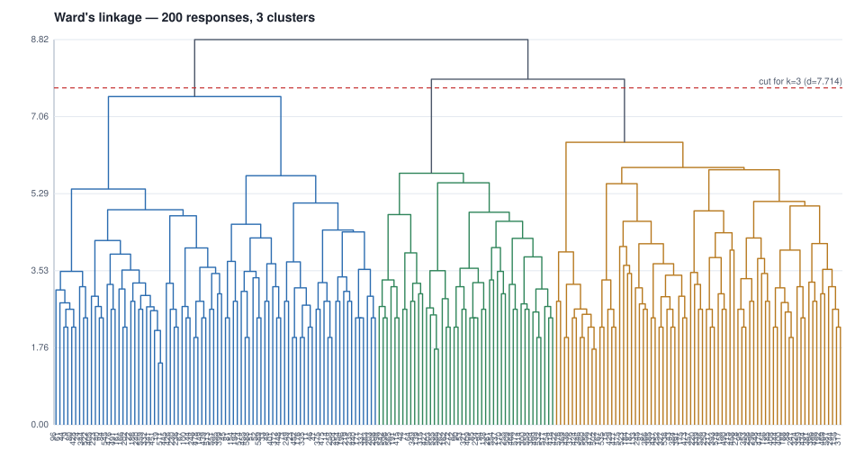

# 04 - Ward's hierarchical cluster analysis over the machine's coding

200 responses x 128 codes after the low-frequency filter
(minimum 2 responses per code: 128 kept, 34 dropped).
Cluster count from the agglomeration schedule: `n_clusters = n_samples - break_stage (Essary 2022, via Chan 2025)` -> largest break at stage
197 of 199 (delta 1.046) -> **3 clusters**, cut at distance 7.714.

| cluster | n | share | members (response ids) |
|---:|---:|---:|---|
| 1 | 82 | 41% | 11, 14, 19, 22, 23, 24, 33, 40, 44, 45, 46, 47, 48, 51, 52, 61, 67, 73, 79, 80, 81, 84, 96, 100, 144, 149, 154, 161, 166, 171, 176, 186, 194, 196, 202, 203, 204, 208, 219, 223, 230, 235, 236, 240, 248, 249, 258, 332, 335, 337, 341, 344, 372, 375, 383, 395, 399, 401, 405, 426, 428, 439, 440, 445, 448, 451, 452, 454, 455, 475, 476, 478, 491, 513, 522, 545, 551, 559, 571, 574, 588, 589 |
| 2 | 45 | 22% | 42, 53, 64, 77, 82, 85, 90, 94, 138, 139, 162, 170, 191, 234, 237, 254, 255, 261, 262, 272, 300, 304, 314, 315, 321, 349, 398, 409, 415, 418, 427, 468, 499, 503, 509, 517, 532, 542, 554, 555, 558, 565, 572, 586, 596 |
| 3 | 73 | 36% | 15, 43, 87, 88, 95, 133, 155, 156, 158, 167, 175, 184, 185, 187, 188, 192, 215, 217, 220, 244, 245, 247, 250, 252, 256, 278, 296, 317, 324, 327, 339, 346, 353, 357, 359, 366, 369, 376, 381, 384, 385, 391, 393, 396, 400, 408, 422, 424, 429, 434, 436, 437, 444, 458, 469, 472, 473, 474, 477, 490, 498, 502, 523, 535, 536, 538, 548, 556, 560, 575, 576, 578, 587 |

## The row universe, and why it is the coded set

The matrix above has **200 rows: the responses his export actually
codes**, not one row per response in the corpus. Clustering the whole corpus would put
every uncoded response in as an identical all-zero row, and Ward's linkage would then
be describing the uncoded majority rather than the coding. Both readings are
legitimate and they answer different questions; this one answers "what structure is in
his coding".

## Cluster 1 - code means (top 10; prominent at >= 0.4)

| code | mean | responses | prominent |
|---|---:|---:|---|
| `AI-productivity_enhancement` | 0.329 | 27 | no |
| `AI-role-human_replacement` | 0.268 | 22 | no |
| `negative_impacts-job_destruction` | 0.232 | 19 | no |
| `negative_impacts-misuse` | 0.232 | 19 | no |
| `ai-dependence-lifestyle` | 0.207 | 17 | no |
| `AI-automation_of_repetitive_tasks` | 0.171 | 14 | no |
| `concern-human_dependency` | 0.171 | 14 | no |
| `AI-multi-use` | 0.159 | 13 | no |
| `AI-positive_outlook` | 0.134 | 11 | no |
| `impact-work_ease` | 0.134 | 11 | no |

## Cluster 2 - code means (top 10; prominent at >= 0.4)

| code | mean | responses | prominent |
|---|---:|---:|---|
| `AI-productivity_enhancement` | 0.889 | 40 | yes |
| `positive_outlook` | 0.622 | 28 | yes |
| `AI-utility` | 0.511 | 23 | yes |
| `impact-technological_advancement` | 0.444 | 20 | yes |
| `positive_outcomes-work_relief` | 0.311 | 14 | no |
| `multi-use` | 0.200 | 9 | no |
| `daily_life_assistance-problem_resolution` | 0.178 | 8 | no |
| `AI-multi-use` | 0.156 | 7 | no |
| `AI-multi_use` | 0.156 | 7 | no |
| `AI-ubiquity` | 0.156 | 7 | no |

## Cluster 3 - code means (top 10; prominent at >= 0.4)

| code | mean | responses | prominent |
|---|---:|---:|---|
| `positive_outlook` | 0.671 | 49 | yes |
| `ubiquity` | 0.438 | 32 | yes |
| `impact-technological_advancement` | 0.370 | 27 | no |
| `AI-utility` | 0.205 | 15 | no |
| `utility-work_ease` | 0.192 | 14 | no |
| `AI-sector-focus-health` | 0.178 | 13 | no |
| `transportation-autonomous_vehicles` | 0.178 | 13 | no |
| `sector-focus-health` | 0.164 | 12 | no |
| `AI-productivity_enhancement` | 0.151 | 11 | no |
| `daily_life_assistance-problem_resolution` | 0.137 | 10 | no |

## Agglomeration schedule

| stage | distance | delta | size |
|---:|---:|---:|---:|
| 1 | 1.414 | 0.000 | 2 |
| 2 | 1.732 | 0.318 | 2 |
| 3 | 1.732 | 0.000 | 2 |
| 4 | 2.000 | 0.268 | 2 |
| 5 | 2.000 | 0.000 | 2 |
| 6 | 2.000 | 0.000 | 2 |
| 7 | 2.000 | 0.000 | 2 |
| 8 | 2.000 | 0.000 | 2 |
| 9 | 2.000 | 0.000 | 2 |
| 10 | 2.000 | 0.000 | 2 |
| 11 | 2.000 | 0.000 | 2 |
| 12 | 2.000 | 0.000 | 2 |
| 13 | 2.160 | 0.160 | 3 |
| 14 | 2.236 | 0.076 | 2 |
| 15 | 2.236 | 0.000 | 2 |
| 16 | 2.236 | 0.000 | 2 |
| 17 | 2.236 | 0.000 | 2 |
| 18 | 2.236 | 0.000 | 2 |
| 19 | 2.236 | 0.000 | 2 |
| 20 | 2.236 | 0.000 | 3 |
| 21 | 2.236 | 0.000 | 2 |
| 22 | 2.236 | 0.000 | 2 |
| 23 | 2.236 | 0.000 | 2 |
| 24 | 2.236 | 0.000 | 2 |
| 25 | 2.236 | 0.000 | 2 |
| 26 | 2.236 | 0.000 | 2 |
| 27 | 2.236 | 0.000 | 2 |
| 28 | 2.236 | 0.000 | 2 |
| 29 | 2.236 | 0.000 | 2 |
| 30 | 2.449 | 0.213 | 2 |
| 31 | 2.449 | 0.000 | 2 |
| 32 | 2.449 | 0.000 | 2 |
| 33 | 2.449 | 0.000 | 2 |
| 34 | 2.449 | 0.000 | 2 |
| 35 | 2.449 | 0.000 | 2 |
| 36 | 2.449 | 0.000 | 2 |
| 37 | 2.449 | 0.000 | 2 |
| 38 | 2.449 | 0.000 | 3 |
| 39 | 2.449 | 0.000 | 2 |
| 40 | 2.449 | 0.000 | 2 |
| 41 | 2.449 | 0.000 | 2 |
| 42 | 2.449 | 0.000 | 2 |
| 43 | 2.449 | 0.000 | 2 |
| 44 | 2.449 | 0.000 | 2 |
| 45 | 2.449 | 0.000 | 2 |
| 46 | 2.449 | 0.000 | 2 |
| 47 | 2.449 | 0.000 | 3 |
| 48 | 2.449 | 0.000 | 2 |
| 49 | 2.517 | 0.067 | 3 |
| 50 | 2.530 | 0.013 | 5 |
| 51 | 2.582 | 0.052 | 3 |
| 52 | 2.582 | 0.000 | 3 |
| 53 | 2.614 | 0.032 | 4 |
| 54 | 2.646 | 0.032 | 3 |
| 55 | 2.646 | 0.000 | 4 |
| 56 | 2.646 | 0.000 | 3 |
| 57 | 2.646 | 0.000 | 3 |
| 58 | 2.646 | 0.000 | 3 |
| 59 | 2.646 | 0.000 | 3 |
| 60 | 2.646 | 0.000 | 3 |
| 61 | 2.646 | 0.000 | 2 |
| 62 | 2.646 | 0.000 | 2 |
| 63 | 2.646 | 0.000 | 2 |
| 64 | 2.646 | 0.000 | 2 |
| 65 | 2.646 | 0.000 | 2 |
| 66 | 2.646 | 0.000 | 2 |
| 67 | 2.646 | 0.000 | 2 |
| 68 | 2.646 | 0.000 | 2 |
| 69 | 2.646 | 0.000 | 2 |
| 70 | 2.646 | 0.000 | 2 |
| 71 | 2.646 | 0.000 | 2 |
| 72 | 2.646 | 0.000 | 2 |
| 73 | 2.651 | 0.005 | 7 |
| 74 | 2.677 | 0.026 | 4 |
| 75 | 2.702 | 0.025 | 5 |
| 76 | 2.708 | 0.006 | 3 |
| 77 | 2.708 | 0.000 | 3 |
| 78 | 2.708 | 0.000 | 3 |
| 79 | 2.708 | 0.000 | 3 |
| 80 | 2.739 | 0.031 | 4 |
| 81 | 2.769 | 0.030 | 3 |
| 82 | 2.769 | 0.000 | 3 |
| 83 | 2.793 | 0.024 | 5 |
| 84 | 2.799 | 0.006 | 4 |
| 85 | 2.828 | 0.030 | 3 |
| 86 | 2.828 | 0.000 | 2 |
| 87 | 2.828 | 0.000 | 2 |
| 88 | 2.828 | 0.000 | 2 |
| 89 | 2.828 | 0.000 | 2 |
| 90 | 2.828 | 0.000 | 2 |
| 91 | 2.828 | 0.000 | 2 |
| 92 | 2.828 | 0.000 | 2 |
| 93 | 2.828 | 0.000 | 4 |
| 94 | 2.828 | 0.000 | 2 |
| 95 | 2.828 | 0.000 | 2 |
| 96 | 2.828 | 0.000 | 2 |
| 97 | 2.828 | 0.000 | 2 |
| 98 | 2.887 | 0.058 | 3 |
| 99 | 2.933 | 0.046 | 5 |
| 100 | 2.944 | 0.011 | 3 |
| 101 | 2.944 | 0.000 | 3 |
| 102 | 2.944 | 0.000 | 4 |
| 103 | 2.962 | 0.018 | 7 |
| 104 | 3.000 | 0.038 | 2 |
| 105 | 3.000 | 0.000 | 3 |
| 106 | 3.000 | 0.000 | 2 |
| 107 | 3.000 | 0.000 | 2 |
| 108 | 3.000 | 0.000 | 2 |
| 109 | 3.055 | 0.055 | 3 |
| 110 | 3.055 | 0.000 | 3 |
| 111 | 3.088 | 0.033 | 6 |
| 112 | 3.109 | 0.022 | 6 |
| 113 | 3.109 | 0.000 | 3 |
| 114 | 3.136 | 0.027 | 6 |
| 115 | 3.136 | 0.000 | 4 |
| 116 | 3.136 | 0.000 | 6 |
| 117 | 3.162 | 0.026 | 3 |
| 118 | 3.162 | 0.000 | 4 |
| 119 | 3.162 | 0.000 | 3 |
| 120 | 3.162 | 0.000 | 3 |
| 121 | 3.162 | 0.000 | 3 |
| 122 | 3.162 | 0.000 | 4 |
| 123 | 3.215 | 0.052 | 3 |
| 124 | 3.215 | 0.000 | 3 |
| 125 | 3.215 | 0.000 | 3 |
| 126 | 3.217 | 0.002 | 9 |
| 127 | 3.240 | 0.023 | 4 |
| 128 | 3.240 | 0.000 | 4 |
| 129 | 3.246 | 0.006 | 9 |
| 130 | 3.256 | 0.009 | 5 |
| 131 | 3.256 | 0.000 | 5 |
| 132 | 3.266 | 0.010 | 3 |
| 133 | 3.317 | 0.051 | 6 |
| 134 | 3.317 | 0.000 | 2 |
| 135 | 3.317 | 0.000 | 5 |
| 136 | 3.347 | 0.030 | 5 |
| 137 | 3.367 | 0.020 | 3 |
| 138 | 3.386 | 0.020 | 5 |
| 139 | 3.425 | 0.039 | 8 |
| 140 | 3.464 | 0.039 | 2 |
| 141 | 3.464 | 0.000 | 3 |
| 142 | 3.464 | 0.000 | 4 |
| 143 | 3.488 | 0.024 | 4 |
| 144 | 3.512 | 0.024 | 9 |
| 145 | 3.512 | 0.000 | 3 |
| 146 | 3.512 | 0.000 | 6 |
| 147 | 3.529 | 0.017 | 7 |
| 148 | 3.543 | 0.015 | 12 |
| 149 | 3.559 | 0.016 | 6 |
| 150 | 3.559 | 0.000 | 6 |
| 151 | 3.584 | 0.025 | 9 |
| 152 | 3.606 | 0.022 | 8 |
| 153 | 3.651 | 0.046 | 3 |
| 154 | 3.688 | 0.036 | 5 |
| 155 | 3.688 | 0.000 | 10 |
| 156 | 3.731 | 0.043 | 8 |
| 157 | 3.742 | 0.011 | 4 |
| 158 | 3.808 | 0.066 | 4 |
| 159 | 3.830 | 0.022 | 6 |
| 160 | 3.844 | 0.014 | 9 |
| 161 | 3.907 | 0.063 | 15 |
| 162 | 3.937 | 0.030 | 6 |
| 163 | 3.959 | 0.022 | 11 |
| 164 | 4.000 | 0.041 | 9 |
| 165 | 4.000 | 0.000 | 2 |
| 166 | 4.049 | 0.049 | 11 |
| 167 | 4.058 | 0.009 | 5 |
| 168 | 4.082 | 0.025 | 4 |
| 169 | 4.146 | 0.063 | 14 |
| 170 | 4.150 | 0.004 | 9 |
| 171 | 4.219 | 0.069 | 19 |
| 172 | 4.269 | 0.049 | 12 |
| 173 | 4.278 | 0.009 | 9 |
| 174 | 4.279 | 0.001 | 11 |
| 175 | 4.397 | 0.118 | 8 |
| 176 | 4.416 | 0.019 | 11 |
| 177 | 4.460 | 0.043 | 16 |
| 178 | 4.592 | 0.133 | 15 |
| 179 | 4.659 | 0.067 | 17 |
| 180 | 4.660 | 0.000 | 18 |
| 181 | 4.786 | 0.126 | 15 |
| 182 | 4.813 | 0.027 | 12 |
| 183 | 4.867 | 0.054 | 26 |
| 184 | 4.899 | 0.032 | 12 |
| 185 | 4.924 | 0.025 | 34 |
| 186 | 5.011 | 0.087 | 18 |
| 187 | 5.079 | 0.067 | 24 |
| 188 | 5.114 | 0.035 | 27 |
| 189 | 5.399 | 0.285 | 43 |
| 190 | 5.521 | 0.122 | 23 |
| 191 | 5.542 | 0.021 | 33 |
| 192 | 5.703 | 0.161 | 39 |
| 193 | 5.760 | 0.057 | 45 |
| 194 | 5.839 | 0.079 | 39 |
| 195 | 5.892 | 0.053 | 62 |
| 196 | 6.469 | 0.577 | 73 |
| 197 | 7.515 | 1.046 | 82 |
| 198 | 7.913 | 0.398 | 118 |
| 199 | 8.820 | 0.907 | 200 |

## Codes dropped by the frequency filter (34)

`AI-data_driven`, `AI-disaster_management`, `AI-divine_connection`, `AI-facilitated-collaboration`, `AI-impact-immigration`, `AI-impact-positive_outlook`, `AI-impact-rapid_change`, `AI-sector-focus-cyber_security`, `AI-transportation-autonomous_vehicles`, `accessibility-free_healthcare`, `daily_life_assistance-automated_reminders`, `deepfakes`, `economic_impact-universal_basic_income`, `education-accessibility`, `education-personalised_learning`, `education-sector_transformation`, `employment_transformation-job_transformation`, `employment_transformation-remote_work`, `enhanced-communication`, `facilitated-collaboration`, `impact-enhanced-communication`, `labor-free_workforce`, `negative_impacts-cybersecurity_risks`, `perception-fleeting_trend`, `perception-technological_luck`, `role_human_replacement`, `safety-human_safety`, `safety-kill_switch`, `safety_improvements`, `sector-focus-hospitality`, `sector-focus-real_estate`, `security-cyber_security`, `transport_automation`, `workforce_retraining`
