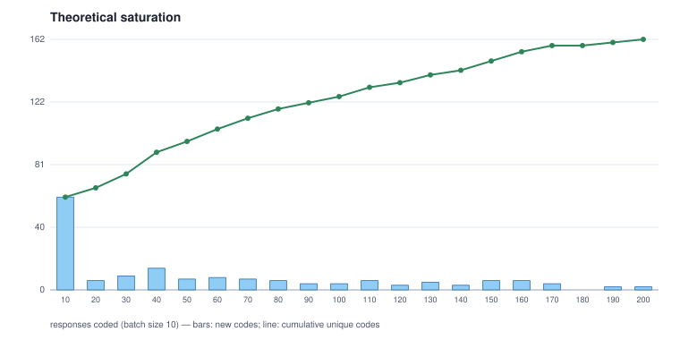

# 05 - Theoretical saturation over the machine's coding

Batch size 10; 162 distinct codes in total; saturated at batch 18.

| batch | responses | cumulative responses | new codes | cumulative codes |
|---:|---:|---|---:|---:|
| 1 | 10 | 10 | 60 | 60 |
| 2 | 10 | 20 | 6 | 66 |
| 3 | 10 | 30 | 9 | 75 |
| 4 | 10 | 40 | 14 | 89 |
| 5 | 10 | 50 | 7 | 96 |
| 6 | 10 | 60 | 8 | 104 |
| 7 | 10 | 70 | 7 | 111 |
| 8 | 10 | 80 | 6 | 117 |
| 9 | 10 | 90 | 4 | 121 |
| 10 | 10 | 100 | 4 | 125 |
| 11 | 10 | 110 | 6 | 131 |
| 12 | 10 | 120 | 3 | 134 |
| 13 | 10 | 130 | 5 | 139 |
| 14 | 10 | 140 | 3 | 142 |
| 15 | 10 | 150 | 6 | 148 |
| 16 | 10 | 160 | 6 | 154 |
| 17 | 10 | 170 | 4 | 158 |
| 18 | 10 | 180 | 0 | 158 |
| 19 | 10 | 190 | 2 | 160 |
| 20 | 10 | 200 | 2 | 162 |

## Batch 1 - new codes (60)

`AI-automation_of_repetitive_tasks`, `AI-complex_problem_solving`, `AI-creative_capability`, `AI-daily_life_assistance`, `AI-disaster_management`, `AI-divine_connection`, `AI-economic_efficiency`, `AI-economic_strengthening`, `AI-employment_transformation`, `AI-enhanced-communication`, `AI-entrepreneurial-support`, `AI-facilitated-collaboration`, `AI-global_defence`, `AI-impact-immigration`, `AI-impact-women_safety`, `AI-mindset_shift`, `AI-multi-use`, `AI-need_for_awareness`, `AI-omnipotence`, `AI-perception-central_role`, `AI-personalisation`, `AI-positive_outlook`, `AI-productivity_enhancement`, `AI-role-expansion`, `AI-role-human_replacement`, `AI-sector-focus-cyber_security`, `AI-sector-focus-defence_education`, `AI-sector-focus-digital_marketing`, `AI-sector_transformation`, `AI-ubiquity`, `accessibility-assistance_for_disabled`, `ai-dependence-lifestyle`, `ai-utility`, `benefit-reduced_stress`, `concern-human_dependency`, `concern-privacy_security`, `economic_impact-productivity_gain`, `education-literacy_requirement`, `impact-communication_enhancement`, `impact-digital_connectivity`, `impact-public_safety`, `impact-technological_advancement`, `impact-work_ease`, `labor-competitive_advantage`, `labor-job_transformation`, `negative_impacts-cybersecurity_risks`, `negative_impacts-job_destruction`, `negative_impacts-laziness`, `negative_impacts-misuse`, `perception-technological_luck`, `positive_outcomes-work_relief`, `resource-efficiency`, `safety-reduced_accidents`, `safety_improvements`, `security-cyber_security`, `society-digital-transformation`, `transport_automation`, `transportation-autonomous_vehicles`, `user_experience_relaxation`, `utility-work_efficiency`

## Batch 2 - new codes (6)

`automation_of_repetitive_tasks`, `economic_impact-universal_basic_income`, `positive_outlook`, `safety-improvements-shelter_security`, `sector_transformation`, `transportation-navigation_assistance`

## Batch 3 - new codes (9)

`AI-superintelligence`, `complex_problem_solving`, `concern-deepfakes`, `concern-ethical_development`, `daily_life_assistance`, `economic_efficiency`, `education-sector-transformation`, `personalisation`, `sector-focus-cyber_security`

## Batch 4 - new codes (14)

`AI-role_expansion`, `AI-sector-focus-health`, `AI-threat-to-humanity`, `AI-utility`, `accessibility-free_healthcare`, `ai-productivity_enhancement`, `complex_problem_solving-advance_analysis`, `daily_life_assistance-problem_resolution`, `employment_transformation`, `impact-digital_exclusion`, `negative_impacts-human_subjugation`, `personalisation-virtual_trials`, `sector-focus-digital_marketing`, `sector-focus-transportation`

## Batch 5 - new codes (7)

`creative_capability`, `daily_life_assistance-automated_payments`, `employment_transformation-job_displacement`, `employment_transformation-workforce_retraining`, `need_for_awareness`, `safety-kill_switch`, `threat-to-humanity`

## Batch 6 - new codes (8)

`AI-behavioral_influence`, `AI-dependence-lifestyle`, `global_defence`, `impact-rapid_change`, `mindset_shift`, `negative_impacts-physical_health`, `society-social_norms`, `ubiquity`

## Batch 7 - new codes (7)

`deepfakes`, `employment_transformation-remote_work`, `job_displacement`, `positive_outlook-wealth_and_happiness`, `privacy_security`, `sector-focus-health`, `utility`

## Batch 8 - new codes (6)

`AI-role_human_replacement`, `ai-unclear_outputs`, `dependence-lifestyle`, `economic_efficiency-recession`, `multi-use`, `need_for_awareness-literacy`

## Batch 9 - new codes (4)

`AI-assistance_for_disabled`, `AI-data_driven`, `AI-multi_use`, `AI-robotics_engineering`

## Batch 10 - new codes (4)

`AI-data-driven`, `complex_problem_solving-scientific_discovery`, `labor-free_workforce`, `sector-focus-hospitality`

## Batch 11 - new codes (6)

`negative_impacts`, `negative_impacts-dual_nature`, `perception-fleeting_trend`, `positive_outcomes-accessible_healthcare`, `positive_outlook-work_relief`, `utility-work_ease`

## Batch 12 - new codes (3)

`AI-transportation-autonomous_vehicles`, `economic_efficiency-productivity_gain`, `robotics_engineering`

## Batch 13 - new codes (5)

`AI-sector-focus-transportation`, `employment_transformation-job_creation`, `mindset_shift-problem_identification`, `privacy_security-safe_sharing`, `sector-focus-education`

## Batch 14 - new codes (3)

`ai-sector-focus-health`, `creative_capability-media_generation`, `facilitated-collaboration`

## Batch 15 - new codes (6)

`daily_life_assistance-automated_reminders`, `education`, `impact-enhanced-communication`, `multi_use`, `perception-central_role`, `personalisation-style_suggestions`

## Batch 16 - new codes (6)

`role_human_replacement`, `safety-human_safety`, `sector-focus-programming`, `sector-focus-real_estate`, `unclear_outputs`, `workforce_retraining`

## Batch 17 - new codes (4)

`education-accessibility`, `education-personalised_learning`, `education-sector_transformation`, `enhanced-communication`

## Batch 18 - new codes (0)

## Batch 19 - new codes (2)

`ai-multi_use`, `employment_transformation-job_transformation`

## Batch 20 - new codes (2)

`AI-impact-positive_outlook`, `AI-impact-rapid_change`
