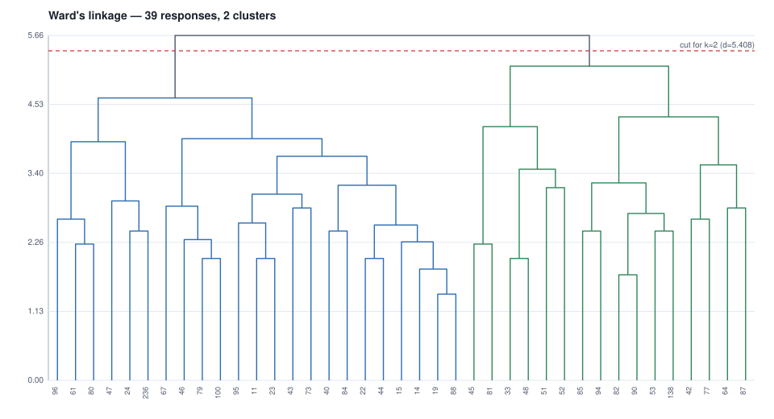

# 04 - Ward's hierarchical cluster analysis over the machine's coding

39 responses x 46 codes after the low-frequency filter
(minimum 2 responses per code: 46 kept, 45 dropped).
Cluster count from the agglomeration schedule: `n_clusters = n_samples - break_stage (Essary 2022, via Chan 2025)` -> largest break at stage
37 of 38 (delta 0.522) -> **2 clusters**, cut at distance 5.408.

| cluster | n | share | members (response ids) |
|---:|---:|---:|---|
| 1 | 23 | 59% | 11, 14, 15, 19, 22, 23, 24, 40, 43, 44, 46, 47, 61, 67, 73, 79, 80, 84, 88, 95, 96, 100, 236 |
| 2 | 16 | 41% | 33, 42, 45, 48, 51, 52, 53, 64, 77, 81, 82, 85, 87, 90, 94, 138 |

## The row universe, and why it is the coded set

The matrix above has **39 rows: the responses his export actually
codes**, not one row per response in the corpus. Clustering the whole corpus would put
every uncoded response in as an identical all-zero row, and Ward's linkage would then
be describing the uncoded majority rather than the coding. Both readings are
legitimate and they answer different questions; this one answers "what structure is in
his coding".

## Cluster 1 - code means (top 10; prominent at >= 0.4)

| code | mean | responses | prominent |
|---|---:|---:|---|
| `ai-dependence-lifestyle` | 0.348 | 8 | no |
| `concern-human_dependency` | 0.348 | 8 | no |
| `AI-ubiquity` | 0.261 | 6 | no |
| `negative_impacts-misuse` | 0.261 | 6 | no |
| `AI-positive_outlook` | 0.217 | 5 | no |
| `AI-role-human_replacement` | 0.217 | 5 | no |
| `negative_impacts-job_destruction` | 0.217 | 5 | no |
| `negative_impacts-laziness` | 0.217 | 5 | no |
| `AI-enhanced-communication` | 0.174 | 4 | no |
| `AI-omnipotence` | 0.174 | 4 | no |

## Cluster 2 - code means (top 10; prominent at >= 0.4)

| code | mean | responses | prominent |
|---|---:|---:|---|
| `AI-productivity_enhancement` | 0.688 | 11 | yes |
| `positive_outlook` | 0.562 | 9 | yes |
| `impact-technological_advancement` | 0.438 | 7 | yes |
| `AI-automation_of_repetitive_tasks` | 0.375 | 6 | no |
| `AI-multi-use` | 0.375 | 6 | no |
| `AI-ubiquity` | 0.375 | 6 | no |
| `AI-employment_transformation` | 0.312 | 5 | no |
| `economic_impact-productivity_gain` | 0.312 | 5 | no |
| `negative_impacts-job_destruction` | 0.312 | 5 | no |
| `labor-job_transformation` | 0.250 | 4 | no |

## Agglomeration schedule

| stage | distance | delta | size |
|---:|---:|---:|---:|
| 1 | 1.414 | 0.000 | 2 |
| 2 | 1.732 | 0.318 | 2 |
| 3 | 1.826 | 0.094 | 3 |
| 4 | 2.000 | 0.174 | 2 |
| 5 | 2.000 | 0.000 | 2 |
| 6 | 2.000 | 0.000 | 2 |
| 7 | 2.000 | 0.000 | 2 |
| 8 | 2.236 | 0.236 | 2 |
| 9 | 2.236 | 0.000 | 2 |
| 10 | 2.273 | 0.037 | 4 |
| 11 | 2.309 | 0.036 | 3 |
| 12 | 2.449 | 0.140 | 2 |
| 13 | 2.449 | 0.000 | 2 |
| 14 | 2.449 | 0.000 | 2 |
| 15 | 2.449 | 0.000 | 2 |
| 16 | 2.550 | 0.100 | 6 |
| 17 | 2.582 | 0.032 | 3 |
| 18 | 2.646 | 0.064 | 2 |
| 19 | 2.646 | 0.000 | 3 |
| 20 | 2.739 | 0.093 | 4 |
| 21 | 2.828 | 0.090 | 2 |
| 22 | 2.828 | 0.000 | 2 |
| 23 | 2.858 | 0.029 | 4 |
| 24 | 2.944 | 0.086 | 3 |
| 25 | 3.055 | 0.111 | 5 |
| 26 | 3.162 | 0.107 | 2 |
| 27 | 3.202 | 0.039 | 8 |
| 28 | 3.240 | 0.039 | 6 |
| 29 | 3.464 | 0.224 | 4 |
| 30 | 3.536 | 0.071 | 4 |
| 31 | 3.677 | 0.141 | 13 |
| 32 | 3.916 | 0.239 | 6 |
| 33 | 3.966 | 0.050 | 17 |
| 34 | 4.163 | 0.197 | 6 |
| 35 | 4.324 | 0.161 | 10 |
| 36 | 4.634 | 0.310 | 23 |
| 37 | 5.157 | 0.522 | 16 |
| 38 | 5.660 | 0.503 | 39 |

## Codes dropped by the frequency filter (45)

`AI-complex_problem_solving`, `AI-creative_capability`, `AI-disaster_management`, `AI-divine_connection`, `AI-economic_strengthening`, `AI-entrepreneurial-support`, `AI-facilitated-collaboration`, `AI-global_defence`, `AI-impact-immigration`, `AI-impact-women_safety`, `AI-personalisation`, `AI-role_expansion`, `AI-sector-focus-cyber_security`, `AI-sector-focus-defence_education`, `AI-sector-focus-digital_marketing`, `AI-sector-focus-health`, `AI-threat-to-humanity`, `AI-utility`, `accessibility-assistance_for_disabled`, `accessibility-free_healthcare`, `ai-productivity_enhancement`, `automation_of_repetitive_tasks`, `complex_problem_solving-advance_analysis`, `concern-deepfakes`, `concern-misuse`, `concern-privacy_security`, `daily_life_assistance-problem_resolution`, `economic_impact-universal_basic_income`, `employment_transformation`, `impact-digital_connectivity`, `impact-digital_exclusion`, `negative_impacts-cybersecurity_risks`, `negative_impacts-human_subjugation`, `perception-technological_luck`, `personalisation-virtual_trials`, `safety-improvements-shelter_security`, `safety-reduced_accidents`, `safety_improvements`, `sector-focus-cyber_security`, `sector-focus-digital_marketing`, `sector-focus-transportation`, `security-cyber_security`, `transport_automation`, `transportation-navigation_assistance`, `ubiquity`
