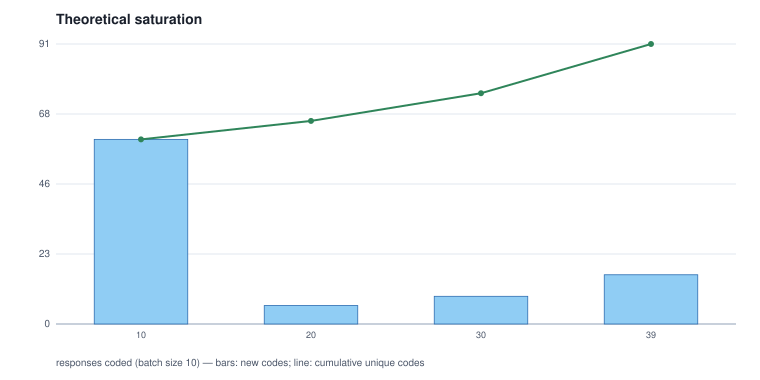

# 05 - Theoretical saturation over the machine's coding

Batch size 10; 91 distinct codes in total; **not saturated**: every batch introduced new codes.

| batch | responses | cumulative responses | new codes | cumulative codes |
|---:|---:|---|---:|---:|
| 1 | 10 | 10 | 60 | 60 |
| 2 | 10 | 20 | 6 | 66 |
| 3 | 10 | 30 | 9 | 75 |
| 4 | 9 | 39 | 16 | 91 |

## Batch 1 - new codes (60)

`AI-automation_of_repetitive_tasks`, `AI-complex_problem_solving`, `AI-creative_capability`, `AI-daily_life_assistance`, `AI-disaster_management`, `AI-divine_connection`, `AI-economic_efficiency`, `AI-economic_strengthening`, `AI-employment_transformation`, `AI-enhanced-communication`, `AI-entrepreneurial-support`, `AI-facilitated-collaboration`, `AI-global_defence`, `AI-impact-immigration`, `AI-impact-women_safety`, `AI-mindset_shift`, `AI-multi-use`, `AI-need_for_awareness`, `AI-omnipotence`, `AI-perception-central_role`, `AI-personalisation`, `AI-positive_outlook`, `AI-productivity_enhancement`, `AI-role-expansion`, `AI-role-human_replacement`, `AI-sector-focus-cyber_security`, `AI-sector-focus-defence_education`, `AI-sector-focus-digital_marketing`, `AI-sector_transformation`, `AI-ubiquity`, `accessibility-assistance_for_disabled`, `ai-dependence-lifestyle`, `ai-utility`, `benefit-reduced_stress`, `concern-human_dependency`, `concern-privacy_security`, `economic_impact-productivity_gain`, `education-literacy_requirement`, `impact-communication_enhancement`, `impact-digital_connectivity`, `impact-public_safety`, `impact-technological_advancement`, `impact-work_ease`, `labor-competitive_advantage`, `labor-job_transformation`, `negative_impacts-cybersecurity_risks`, `negative_impacts-job_destruction`, `negative_impacts-laziness`, `negative_impacts-misuse`, `perception-technological_luck`, `positive_outcomes-work_relief`, `resource-efficiency`, `safety-reduced_accidents`, `safety_improvements`, `security-cyber_security`, `society-digital-transformation`, `transport_automation`, `transportation-autonomous_vehicles`, `user_experience_relaxation`, `utility-work_efficiency`

## Batch 2 - new codes (6)

`automation_of_repetitive_tasks`, `economic_impact-universal_basic_income`, `positive_outlook`, `safety-improvements-shelter_security`, `sector_transformation`, `transportation-navigation_assistance`

## Batch 3 - new codes (9)

`AI-superintelligence`, `complex_problem_solving`, `concern-deepfakes`, `concern-ethical_development`, `daily_life_assistance`, `economic_efficiency`, `education-sector-transformation`, `personalisation`, `sector-focus-cyber_security`

## Batch 4 - new codes (16)

`AI-role_expansion`, `AI-sector-focus-health`, `AI-threat-to-humanity`, `AI-utility`, `accessibility-free_healthcare`, `ai-productivity_enhancement`, `complex_problem_solving-advance_analysis`, `concern-misuse`, `daily_life_assistance-problem_resolution`, `employment_transformation`, `impact-digital_exclusion`, `negative_impacts-human_subjugation`, `personalisation-virtual_trials`, `sector-focus-digital_marketing`, `sector-focus-transportation`, `ubiquity`
